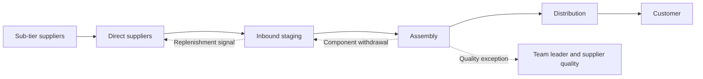

# Toyota supply chain case study

**Decision question.** How can a pull-based vehicle supply chain protect continuity at high-risk parts and routes while keeping routine replenishment lean?

Toyota describes Just-in-Time and jidoka as the two pillars of its production system. This case traces how demand, materials and exceptions move across the network, then uses Toyota's response to the 2011 Great East Japan Earthquake to develop a pilot for selective resilience. The analysis uses public disclosures. The stress test is an independent illustration with synthetic inputs.

## From customer demand to recovery

| Stage | Flow and control | Evidence or analytical interpretation |
|---|---|---|
| Procurement | Suppliers produce materials and components across multiple geographic regions. | Toyota's FY2025 filing describes local and cross-border sourcing. Shared sub-tier sites can create dependencies across nominally independent suppliers. [1] |
| Inbound logistics | Replenishment responds to downstream withdrawal. | Toyota describes the pull loop between upstream and downstream processes. Pickup routes and component supermarkets are places to measure delay and buffer exposure. [2] |
| Assembly | Work moves through synchronized processes. Jidoka surfaces an abnormality so it can be corrected at the source. | Toyota's plant tour illustrates the andon escalation process. Supplier constraint escalation is a proposed extension of the same visibility principle. [2] |
| Distribution | Finished vehicles move toward markets, and service parts flow through a distinct aftermarket network. | Toyota discusses efficient distribution and customer service in its filings. Track vehicle dispatch and service-parts availability separately because they have different service promises. [1] [3] |
| Disruption recovery | Procurement and production coordinate around affected suppliers and infrastructure. | Toyota disclosed parts shortages and infrastructure damage after March 2011. It later documented supplier information-sharing and the RESCUE database. [4] [5] |

**Material flow** runs from sub-tier suppliers to direct suppliers, inbound staging, assembly, distribution and customers. **Information flow** runs back from consumption to replenishment, while quality and supply exceptions travel to the teams that can resolve them. Measure time at each handoff so a transport delay, an inventory discrepancy and a genuine production shortfall trigger different actions.

## What the 2011 disruption reveals

The earthquake simultaneously affected supplier output and transport, utilities and communications. Toyota temporarily suspended domestic factory operations and began restarting in stages on March 18. A shared dependency could therefore interrupt several assembly paths at once. Counting direct suppliers alone would miss that dependency. Toyota's later RESCUE disclosure shows how structured information-sharing can accelerate identification of exposed operations. The next analytical step is to compare recovery time against usable coverage for each critical part. [4] [5]

## Prioritized improvement plan

| Horizon | Proposed intervention | Owner | Measurement and decision |
|---|---|---|---|
| Days 1–30 | Select one platform and map its critical parts to sub-tier production sites and alternate routes. | Purchasing and supplier quality | Review the fraction of pilot parts with validated site, shared dependency and recovery estimates. Include an explicit unknown status. |
| Days 31–60 | Estimate time to survive from accessible and released stock. Simulate base and severe recovery times for each part. | Materials planning | Rank parts by uncovered days and daily vehicle exposure. Validate stock availability at the point of use before setting coverage. |
| Days 61–90 | Compare a small targeted buffer, an alternate route and qualified secondary capacity for exposed parts. Run a tabletop event. | Plant logistics and procurement | Compare uncovered days, time to detect, time to restore, working capital and quality approval lead time. Use the same adverse scenario for each option. |
| After pilot | Add supply exceptions to the operating review and rehearse recovery quarterly. | Plant operations | Track supplier response time, line-stop minutes attributable to shortages, buffer expiry and service-parts fill rate. |

**Operating rule.** Preserve standard pull replenishment on predictable lanes. Review supplemental protection when a critical dependency has a documented recovery gap. Re-evaluate it when alternate capacity qualifies or disruption risk changes.

## Reproduce the illustrative stress test

Run `python stress_test.py` with Python 3.10+. The output estimates stand-alone part exposure under two recovery assumptions. Coverage equals usable units divided by daily consumption. Uncovered days equal the positive difference between recovery time and coverage. This assumes constant consumption and zero replenishment until full recovery. Part-level exposure is deliberately calculated independently because shortages on the same vehicle line can overlap.

| Part | Baseline coverage | Severe recovery | Uncovered days | Uncovered days with listed mitigation |
|---|---:|---:|---:|---:|
| Power controller | 4 | 16 | 12 | 3 |
| Wiring harness | 3 | 8 | 5 | 2 |
| Seat frame | 5 | 6 | 1 | 1 |
| Fastener kit | 7 | 5 | 0 | 0 |

Under the severe scenario, qualifying alternate recovery for the controller closes nine days of exposure. Covering the harness with three additional days of stock closes three days. A live business case would need site-level inventory accessibility, supplier restart curves, qualification costs and line-level dependencies.

## Sources

1. [Toyota FY2025 Form 20-F](https://global.toyota/pages/global_toyota/ir/library/sec/20-F_202503_final.pdf), supply chain and procurement disclosures.
2. [Toyota Virtual Plant Tour, Toyota Production System](https://global.toyota/en/company/plant-tours/production-system/), pull production and jidoka.
3. [Toyota FY2021 Form 20-F](https://global.toyota/pages/global_toyota/ir/library/sec/20-F_202103_final.pdf), application of TPS to logistics and customer service.
4. [Toyota FY2011 Form 20-F](https://global.toyota/pages/global_toyota/ir/library/sec/20-F_201103_final.pdf), earthquake impact and restart.
5. [Toyota Sustainability Data Book 2020](https://global.toyota/pages/global_toyota/sustainability/report/sdb/sdb2007_en.pdf), supplier coordination and RESCUE.
